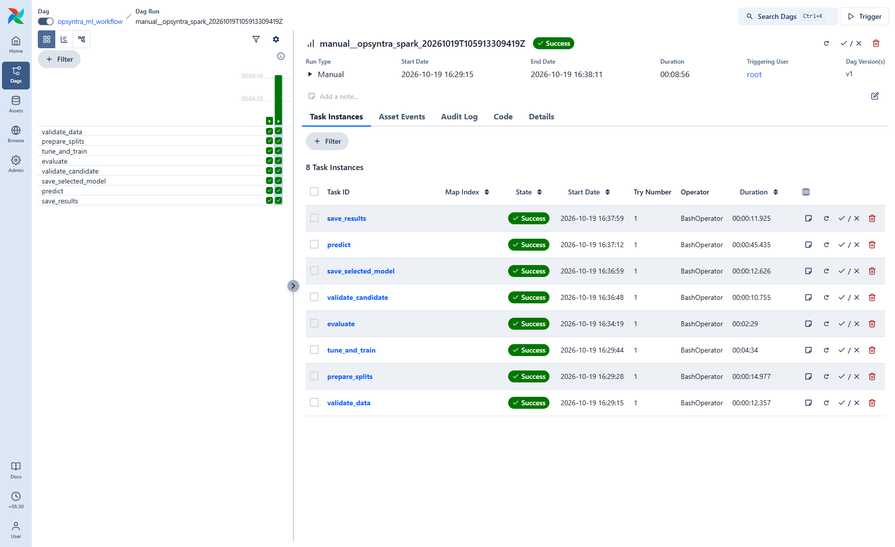
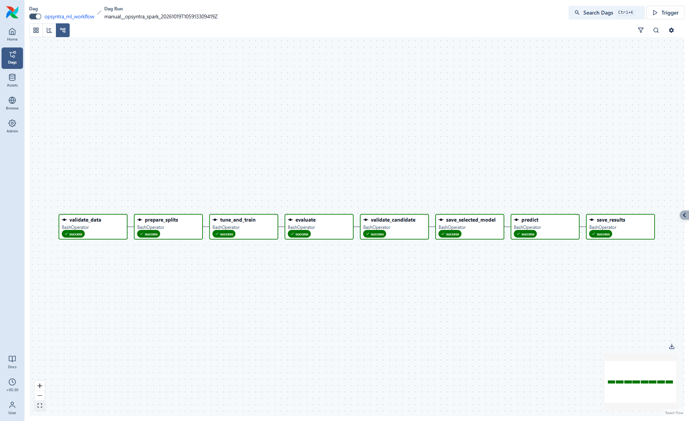

# Airflow ML workflow checkpoint

Both engines completed all eight tasks through the actual Airflow 3.3.2 scheduler and LocalExecutor in Ubuntu WSL.
These are scheduled DagRuns, with saved task states, native model artifacts and actual batch predictions.

```text
validate_data -> prepare_splits -> tune_and_train -> evaluate
             -> validate_candidate -> save_selected_model -> predict -> save_results
```

| Engine | DAG state | Successful tasks | Selected model | Validation AP | Threshold | Test F1 | Saved predictions |
|---|---|---:|---|---:|---:|---:|---:|
| sklearn | success | 8/8 | random_forest | 0.662603 | 0.276342 | 0.620833 | 2 |
| spark | success | 8/8 | random_forest | 0.661753 | 0.259173 | 0.623431 | 2 |

Model ranking uses validation average precision; thresholds maximize validation F1. Only the selected model receives held-out test scores. Test scores are not an approval gate.

## Completed runs and saved outputs

### sklearn

Run ID: `manual__opsyntra_sklearn_20261019T105642410638Z`.
Started: 2026-10-19T10:56:44.297236+00:00; finished: 2026-10-19T10:58:09.499480+00:00 (UTC).

- [Final prediction CSV](../artifacts/airflow/runs/sklearn/manual__opsyntra_sklearn_20261019T105642410638Z-3b22596274da/results/predictions.csv)
- [Result summary](../artifacts/airflow/runs/sklearn/manual__opsyntra_sklearn_20261019T105642410638Z-3b22596274da/results/summary.md)
- [Candidate approval checks](../artifacts/airflow/runs/sklearn/manual__opsyntra_sklearn_20261019T105642410638Z-3b22596274da/approval.json)
- [Selected model metadata](../artifacts/airflow/runs/sklearn/manual__opsyntra_sklearn_20261019T105642410638Z-3b22596274da/selected_model.json)
- [Per-task logs](../artifacts/airflow/runs/sklearn/manual__opsyntra_sklearn_20261019T105642410638Z-3b22596274da/logs/)
- MLflow experiment: **Opsyntra-Airflow**; workflow run `822ac775da3243a3ba9f6a8d5ddbad7a`.


[Successful final task log](../../docs/screenshots/airflow-log-sklearn.png)

### spark

Run ID: `manual__opsyntra_spark_20261019T105913309419Z`.
Started: 2026-10-19T10:59:15.367681+00:00; finished: 2026-10-19T11:08:11.468686+00:00 (UTC).

- [Final prediction CSV](../artifacts/airflow/runs/spark/manual__opsyntra_spark_20261019T105913309419Z-0febd3972a81/results/predictions.csv)
- [Result summary](../artifacts/airflow/runs/spark/manual__opsyntra_spark_20261019T105913309419Z-0febd3972a81/results/summary.md)
- [Candidate approval checks](../artifacts/airflow/runs/spark/manual__opsyntra_spark_20261019T105913309419Z-0febd3972a81/approval.json)
- [Selected model metadata](../artifacts/airflow/runs/spark/manual__opsyntra_spark_20261019T105913309419Z-0febd3972a81/selected_model.json)
- [Per-task logs](../artifacts/airflow/runs/spark/manual__opsyntra_spark_20261019T105913309419Z-0febd3972a81/logs/)
- MLflow experiment: **Opsyntra-Airflow**; workflow run `029bf43d71c443b7b38eb52d5e7803c3`.





[Successful final task log](../../docs/screenshots/airflow-log-spark.png)

## Scheduled task duration

These durations include subprocess startup and orchestration overhead. They are not the engine fit/inference benchmark from Step 4.

| Task | sklearn seconds | Spark seconds |
|---|---:|---:|
| validate_data | 14.500 | 12.357 |
| prepare_splits | 7.528 | 14.976 |
| tune_and_train | 17.586 | 274.323 |
| evaluate | 9.410 | 149.033 |
| validate_candidate | 6.921 | 10.755 |
| save_selected_model | 7.165 | 12.626 |
| predict | 8.102 | 45.435 |
| save_results | 8.858 | 11.925 |

## Reproducibility and operational checks

- Frozen raw data, prediction input, configuration and membership files are checksum-verified by downstream tasks.
- Existing 4,225/1,409/1,409 customer memberships are reused; training folds alone fit imputation, encoding, scaling and classifiers.
- Both approved models passed save/reload probability and label checks. The predict task loaded the approved artifact in a separate process and accepted CSV rows without Churn.
- Candidate gates check validation metrics, dummy improvement, threshold range, data identity and artifact integrity. Approved artifacts are copied into the run's selected directory.
- Retries: 2, with a 20-second delay. Per-task timeout: 30 minutes; DAG timeout: 120 minutes. One active run and one active task avoid overlapping local training.
- Every task writes a log and per-attempt status/timing JSON. Failed upstream tasks block downstream outputs; retries replace final CSVs rather than appending duplicates.
- Run artifacts are isolated by engine and sanitized, hashed run ID. The application frontend's model is not automatically replaced.
- The workflow and all seven candidate runs are recorded in the existing Windows MLflow store, keeping artifact paths accessible from its UI.

Dataset SHA256: `88be4b93fbe0cc83421af1c503794c97c342eca914c1576db7c276e61d61358a`.
Membership SHA256: `b51f7b090312e8c727b11753dd740acdadad3e47d01c2261fe76fb5421b4e82c`.

The JSON report retains scheduler task states, attempt events, approvals, model/data identifiers, predictions and MLflow IDs. Screenshots show the real local UI and are linked to scheduler run IDs in `docs/screenshots/airflow-evidence.json`.

See [DAG setup and commands](../dags/README.md). Airflow's local automatic admin login is bound to loopback for development; shared deployment requires a separate deployment/authentication configuration.
