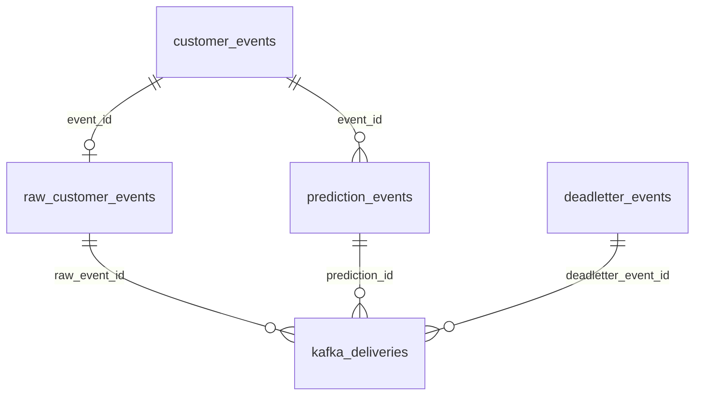

# Phase 2: PostgreSQL analytics contract

This phase adds durable storage and its contracts. The existing prediction
consumer and SQLite recovery ledger continue running independently. Phase 3
adds the [Kafka-to-PostgreSQL consumer](ANALYTICS_CONSUMER.md); Phase 4 will add HTTP analytics and
live frontend screens. Model inference is not repeated by this storage layer.

## Local setup

Run from the repository root in PowerShell, using the Python environment in
which you installed the project's backend dependencies:

```powershell
.\start-analytics.ps1 -Task setup
.\start-analytics.ps1 -Task status
.\start-analytics.ps1 -Task test
```

`setup` installs the optional [analytics requirements](../backend/requirements/analytics.txt),
installs PostgreSQL in Ubuntu WSL if needed, creates a dedicated native-Linux
cluster on **127.0.0.1:5433**, generates random credentials in ignored
`backend/.env`, and applies the versioned migrations. PostgreSQL data is under
`/var/lib/postgresql/opsyntra-<checkout-hash>/data`, outside Windows-mounted disk
storage. Its Unix socket is in a directory accessible only by the PostgreSQL
OS account/root; TCP logins use SCRAM passwords. The admin account has no TCP
password. The helper does not enable remote listening. Ubuntu's package may
also create its own default 5432 cluster; Opsyntra uses only its dedicated 5433
cluster. No cloud resources are provisioned.

`setup` preserves an existing local cluster and its credentials. It refuses to
overwrite an existing analytics configuration or an untracked data directory.
An incomplete initialization fails explicitly rather than replacing data.
The ignored `backend/.analytics-runtime/local.json` is local bootstrap state
and contains passwords; do not share it or `.env`.

```powershell
.\start-analytics.ps1 -Task start    # after a WSL/computer restart
.\start-analytics.ps1 -Task migrate # apply new migrations or verify existing hashes
.\start-analytics.ps1 -Task stop    # stops only this cluster; keeps data
```

Select a free port on first setup with `-Port 5543`. Further starts use the
port saved in local state. For a different PostgreSQL server, provision the
roles/databases using [administrator instructions](../backend/migrations/README.md),
fill in [backend/.env.example](../backend/.env.example), and run the Python
commands below. Environment variables override `.env`; placeholders are rejected.
The launcher uses Ubuntu WSL for local service management, while the storage
library and migrations work with PostgreSQL from either Windows or Linux.

```powershell
cd backend
python -m pipelines.analytics_db migrate
python -m pipelines.analytics_db status
python -m pipelines.analytics_check
```

`status` uses the reader login. An empty `metrics` array is expected before
ingestion starts: Phase 2 creates the main schema but sends test fixtures only
to a **separate test database**. Tests refuse to run with the main database name.
No raw dataset or trained model is required by the analytics checks.

## Roles and migration ownership

| Identity | Purpose | Privileges |
|---|---|---|
| `opsyntra_analytics_owner` | Release/migration login | Owns analytics database/schema; applies DDL; no superuser/role creation |
| `opsyntra_analytics_writer` | NOLOGIN group | SELECT and INSERT on fact/identity/provenance tables; SELECT views |
| `opsyntra_analytics_ingest` | Ingestion login | Inherits writer group; cannot UPDATE, DELETE, TRUNCATE, create schema/tables or assume owner |
| `opsyntra_analytics_reader` | NOLOGIN group | SELECT on facts and views |
| `opsyntra_analytics_api` | API login | Inherits reader group; cannot write |

The migration connection is never used by ingestion/API code. The read
connection also requests read-only transactions; tests disable this client
setting and verify the actual server grants still reject writes. Both app roles
lack migration-table access and public schema creation privileges. Future
migrations must explicitly grant only their needed table/view privileges.

Migrations are forward-only SQL files under `backend/migrations/`, recorded in
`analytics.schema_migrations` with version, filename, checksum and applied time.
The runner takes a PostgreSQL advisory transaction lock and applies all pending
DDL and version records atomically. Migration hashes normalize UTF-8 SQL to LF
line endings so Git's Windows CRLF checkout does not look like a schema edit.
Reruns are safe; edited applied files,
missing history and out-of-order versions fail. Append a new migration rather
than editing an applied one. Failed migrations roll back their DDL and version.
Back up a deployed database before schema upgrades; no automatic destructive
downgrade is provided.

## Tables and event identities



| Table | Logical key | Contents |
|---|---|---|
| `customer_events` | `event_id` UUID | Shared customer/time identity, created by either raw or prediction arrival |
| `raw_customer_events` | `event_id` UUID | All 19 original feature values as JSONB, optional historical Churn separately, raw payload, run/mode/source row/dataset checksum |
| `prediction_events` | `prediction_id` SHA-256 | Event/customer, engine, model version, probability, Yes/No label, timestamps, first payload |
| `deadletter_events` | dead-letter `event_id` UUID | Original event ID when available, error, original Kafka coordinates, raw bytes/checksum/truncation flags in JSON payload |
| `kafka_deliveries` | cluster/topic/partition/offset | Physical output provenance, canonical JSON hash, message key, exactly one reference to a logical fact |

Raw features stay as they were in the event: `TotalCharges: null` remains null;
this layer does not fit imputers or replace missing features. Contract and
payment method are generated columns from the saved feature JSONB. Complete
customer fields remain available in `features` and the original `payload`.
Event IDs/run IDs are UUIDs and prediction IDs are lowercase 64-character
SHA-256 values, matching the current producers/consumer.

Composite foreign keys through `customer_events` enforce the same customer and
event timestamp for raw and predicted facts, even when predictions arrive first.
There is deliberately no prediction-to-raw foreign key that would require raw
arrival first. `prediction_details` LEFT JOINs raw facts by **event_id** and
exposes `raw_available`; an unmatched prediction remains visible, and gains
its original feature profile when the matching raw record later arrives.

Repeated legitimate events from the same customer use different event IDs and
remain separate facts. A later customer contract never rewrites the features
of an earlier event. Predictions for different engines/model versions remain
separate; a unique `(event_id, engine, model_version)` also prevents assigning
multiple logical prediction IDs to one event/model result.

Indexes cover event time, customer/time, engine/model/time, probability-ranked
risk queries, contract/payment segmentation, dead-letter time and delivery links.

## Duplicate and conflict policy

The [`AnalyticsStore`](../backend/src/opsyntra/analytics/storage.py) validates
the current version-1 raw, prediction and dead-letter JSON contracts, normalizes
identity/timestamps, and uses bound PostgreSQL parameters. SQL identifiers are
selected from internal names, never input strings.

```python
from opsyntra.analytics.config import AnalyticsConfig
from opsyntra.analytics.contracts import Source
from opsyntra.analytics.storage import AnalyticsStore

config = AnalyticsConfig.from_env()
with config.connect("write") as connection:
    result = AnalyticsStore(connection).ingest(
        "prediction", decoded_prediction_payload,
        source=Source(cluster_id, topic, partition, offset),
        key=customer_id,
    )
```

- Identical logical replay: no new fact; new physical Kafka coordinates add
  provenance only. Replaying the same coordinate adds neither.
- An inference retry can regenerate `processed_ts`. It is excluded from the
  prediction/dead-letter logical content hash; the first stored processing time
  and payload remain unchanged. Probability, label, customer, event time, model,
  error and source fields still participate in conflict detection.
- Reusing an event/prediction ID with different logical contents raises
  `EventConflict`. A raw/prediction customer or event-time mismatch also fails.
- A physical Kafka coordinate is immutable: a different payload, message key,
  logical ID or kind at that coordinate is a conflict. Its payload SHA is over
  canonical parsed JSON, not the original serialized JSON bytes.
- Dead-letter source coordinates are additionally unique. Corrupt untruncated
  base64/checksum combinations are rejected.
- Every operation commits identity, fact and delivery together, or rolls all
  three back. Concurrent identical inserts yield one logical row. The store
  can nest inside an outer transaction for a future Kafka batch.

Conflicts are raised to the caller without overwriting accepted data. Phase 3
must explicitly quarantine/record analytics failures and commit Kafka input
offsets **after** the database transaction succeeds. Phase 2 does not consume
or commit Kafka offsets and does not claim exactly-once Kafka transport.

## Dashboard definitions

Metrics must specify an **event-time window**, engine and model version. Time
windows use `[start, end)` bounds. `prediction_metrics_by_model` provides the
all-time reference aggregation; windowed API queries will use the same formulas
after filtering `prediction_details`. Always count logical facts, not deliveries.

| Term | Definition |
|---|---|
| Prediction volume | Number of unique stored `prediction_id` rows in the chosen scope |
| Unique events | Distinct `event_id`; one customer may generate several |
| Unique customers | Distinct `customer_id` in those predictions |
| Predicted churn share | Predictions labelled Yes / prediction volume; fraction 0–1 |
| Mean risk | Average `churn_probability`; fraction 0–1, not percent until rendered |
| Processing latency | `processed_ts - event_ts`, seconds; includes broker/backlog/synthetic source delay |
| Ingestion latency | Database `ingested_at - processed_ts`, seconds; separate from model inference time |
| Matched raw predictions | Predictions whose exact `event_id` has raw features; report coverage for segmentation |
| Clock skew count | Predictions with negative processing or ingestion latency; retained and flagged |

These are predictions, **not observed churn rate or accuracy**. Historical
`Churn` in the source is not automatically an outcome measured after these
synthetic event timestamps. Accuracy requires a separately defined labelled
evaluation/outcome join. Predicted labels use each model's selected threshold;
an eventual high-risk probability filter must state its own cutoff instead of
assuming every model uses 0.5.

The aggregate view intentionally separates engine/model. Summing across both
engines counts multiple results for the same customer request. Unmatched raw
events do not disappear from volume/risk metrics; contract/payment reports must
show unmatched coverage rather than interpreting null profiles as a real segment.

## Time policy

All facts use PostgreSQL `timestamptz`; connections and the local server use UTC.
`event_ts` is the producer's event time, `processed_ts` is the prediction/error
producer's time, and `ingested_at` is generated by PostgreSQL `clock_timestamp()`
on first insert. Replays do not reset ingestion time. UTC offsets are normalized
for comparison. Existing raw v1 events require a UTC timestamp; prediction/error
timestamps with explicit other offsets can be normalized. Naive timestamps fail.

The display timezone defaults to `Asia/Colombo` through
`OPSYNTRA_ANALYTICS_TIMEZONE`, validated as an IANA timezone. Convert at the API/UI
boundary, for example `utc_datetime.astimezone(ZoneInfo(config.display_timezone))`.
Local-day/hour buckets must use that timezone explicitly when introduced;
Phase 2 does not change frontend timestamps. Negative latencies are exposed as
clock-skew flags, not silently clipped. Demo historical event timestamps can
produce large ingestion delays; do not present those as inference benchmarks.

## Verification

[Actual PostgreSQL results](../backend/reports/analytics_verification.md),
[JSON evidence](../backend/reports/analytics_verification.json) and
[test log](../backend/reports/analytics_verification.log) record the outcome.
Run `start-analytics.ps1 -Task test` for all Phase 2 checks. Ordinary backend
discovery runs contract tests but skips opt-in PostgreSQL integration tests;
the dedicated verifier fails if any Phase 2 test is skipped. Fixtures use UUIDs
inside `opsyntra_analytics_test`; no truncation or existing Kafka offsets are used.

The [backend regression report](../backend/reports/analytics_regression.json)
records 96 passing tests out of 100, with four native Spark checks skipped on
Windows. It includes the 22 passing Phase 2 contract/PostgreSQL tests. Run
`python -m pipelines.analytics_check --regression` from `backend/` to repeat
both the dedicated checks and the wider suite. Phase 1's verification reports
remain preserved as their own earlier checkpoint.

Implementation references: PostgreSQL [constraints](https://www.postgresql.org/docs/current/ddl-constraints.html),
[timestamp types](https://www.postgresql.org/docs/current/datatype-datetime.html),
[role grants](https://www.postgresql.org/docs/current/sql-grant.html), and Psycopg
[transaction/savepoint behavior](https://www.psycopg.org/psycopg3/docs/basic/transactions.html).
