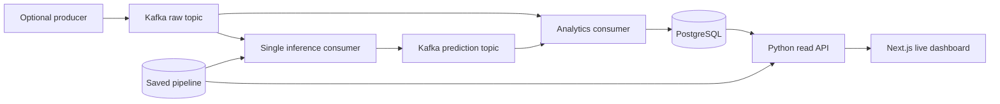

# Local Docker system

Run commands from the repository root. Docker Desktop must run Linux containers;
Python 3 is needed only for the optional setup/verification helpers. The Docker
images install their own pinned Python 3.12 dependencies and Node 22 dependencies.
The normal core does not start Spark, MLflow or Airflow.



## Start

1. Put the original Telco CSV at
   `backend/data/raw/WA_Fn-UseC_-Telco-Customer-Churn.csv`. It is excluded from Git
   and image builds. To use another location, change `OPSYNTRA_DATASET_PATH` in
   the root `.env` to that CSV. Bind mounting refuses to create a missing file.
2. Run `python containers/configure.py`. This creates the ignored root `.env`
   with four distinct random passwords. It preserves an existing `.env`.
   Alternatively copy `.env.example` to `.env` and replace all password placeholders
   with distinct random hexadecimal values. This file is separate from `backend/.env`.
3. Stop competing WSL/Windows services or choose unused ports in the root `.env`.
   The default UI/API/Kafka ports are 3000/8000/9092; PostgreSQL uses 5434.
4. Run:

```powershell
docker compose up --build
```

For background startup with health checks:

```powershell
.\start-containers.ps1 -Task start
docker compose ps --all
```

Open <http://127.0.0.1:3000>. On first startup, `model-init` validates the CSV,
creates deterministic train/validation/test memberships and trains the four
scikit-learn candidates with the existing validation selection policy. It saves
the complete selected pipeline, reports and MLflow runs. This can take several
minutes after image downloads. The API waits for model initialization and database
migrations to finish. `db-init`, `topics-init`, `model-init` exiting with code 0
is expected. Future startups verify the source/config/model receipt and reuse
the saved model; they do not retrain silently. No host Joblib file is imported.

Generate real events, then select **Live monitoring** in the UI:

```powershell
.\start-containers.ps1 -Task demo -DemoEvents 20
# Continuous sampling, foreground; Ctrl+C stops this producer:
docker compose run --rm --no-deps producer producer --mode streaming --events-per-sec 5 --exclude-churn
# Batch with a persistent checkpoint; repeat this command to resume:
docker compose run --rm --no-deps producer producer --mode batch --batch-size 500 --exclude-churn
```

The core starts inference and analytics consumers continuously. The producer is
optional to avoid filling storage while idle. Both direct customer and CSV/API
predictions remain available. Synthetic sampling is a simulation, not company
churn trends. The supplied logo is included unchanged in the frontend image.

## Paths, roles and persistence

| Named volume suffix | Contents |
| --- | --- |
| `postgres` | Analytics logical facts, physical deliveries, errors and migrations |
| `kafka` | Broker log, group offsets and KRaft metadata |
| `data` | Imported CSV, normalized data and fixed memberships |
| `models` | Selected/candidate scikit-learn pipelines and training receipt |
| `artifacts` | Inference SQLite outbox, locks, producer checkpoints, workflow runs and Spark artifacts |
| `reports` | Validation, model comparison and workflow reports |
| `tracking`, `mlartifacts` | MLflow SQLite database and logged models/plots |
| `airflow` | Optional Airflow metadata, logs and authentication state |

Compose prefixes volume names with `COMPOSE_PROJECT_NAME`. Containers connect
to `kafka:29092`, `postgres:5432`, `api:8000`. Kafka separately advertises the
configured Windows host port to host clients. Host ports bind to `127.0.0.1`.
These plaintext, single-broker services are for a local demo.

The API receives only a reader password and mounts model/data/report volumes
read-only. The analytics consumer receives only a writer password. A one-shot
initializer owns migrations and provisions restricted reader/writer login roles.
Database passwords are server environment settings; they never use `NEXT_PUBLIC_`
and the image context excludes `.env` files. Changing the PostgreSQL administrator
password in `.env` alone does not rotate an existing cluster's password: change
the stored role password deliberately before changing that setting.

`container_runtime.py` derives absolute Linux paths from the project config and
sets `OPSYNTRA_CONFIG=/tmp/opsyntra-config.yaml`. The API and Airflow task entry
points honor it. `OPSYNTRA_ML_PYTHON` selects the DAG task interpreter instead of
the WSL default. `OPSYNTRA_ARTIFACT_DIR` can relocate container artifact paths;
mount that location persistently in every service that uses it. The default
shared path `/app/backend/artifacts` works with the existing DAG safety checks.

Keep **one inference replica**. Its per-project fixed container name prevents
`--scale inference=2`; the application also takes its existing group lock.
Recovery remains at-least-once: acknowledged output can be replayed after a
crash. Stable IDs and database constraints deduplicate logical predictions.
Scaling or Fargate replacement needs a separately designed shared recovery store.

## Stop, restart and reset

```powershell
# Preserve every named volume:
.\start-containers.ps1 -Task stop
# Or: docker compose --profile '*' down
.\start-containers.ps1 -Task start
docker compose restart inference analytics api frontend
```

Use `docker compose logs --tail 100 inference analytics` for consumer logs and
`GET /api/analytics/health` for database/broker readiness and consumer lag.
Container consumer health checks test dependencies/model availability; dashboard
lag/ingestion timestamps are still needed to assess actual progress.

To intentionally delete **all data for this Compose project**, including models,
broker offsets and recovery history:

```powershell
.\start-containers.ps1 -Task reset -ConfirmReset
# Equivalent destructive command: docker compose --profile '*' down --volumes
```

Normal stop never uses `--volumes`. A different source CSV should use a new
`COMPOSE_PROJECT_NAME` with fresh volumes, preserving the original project.
For deliberate model retraining with unchanged data, stop inference/API first,
then run `docker compose run --rm --no-deps model-init train`. Select a new
`OPSYNTRA_INFERENCE_GROUP_ID` in the root `.env` for a changed model and restart API/inference;
the old SQLite identity is deliberately rejected rather than silently reused.

## Optional heavy services

```powershell
docker compose --profile mlflow up -d mlflow
# UI: http://127.0.0.1:5000
docker compose --profile spark run --build --rm spark-worker
```

Spark has Java 21 and the hash-locked Spark Python environment. It reuses the
core memberships and stores its outputs in the shared artifact/report volumes.
Avoid simultaneous training processes writing the same report/tracking paths.
For Airflow, build the ML/Spark base first and then the separate Airflow image:

```powershell
docker compose --profile spark build spark-worker
docker compose --profile airflow up --build -d airflow
docker compose logs --tail 100 airflow
```

Airflow uses the official 3.3.2 Python 3.12 image and its own dependency environment;
DAG ML tasks use `/opt/opsyntra-ml/bin/python`. All task processes share the same
artifact/data/report volumes. The local standalone instance has persistent
metadata/logs and is available on <http://127.0.0.1:8081>; use the login information
in its startup output. It is isolated from the existing WSL Airflow installation.
Increase Docker Desktop memory before heavy profiles (6–8 GB is a useful starting
allocation; actual needs depend on training). The core is the default acceptance
path; the verification report states which optional profiles were exercised.

## Reproduce acceptance checks

```powershell
python containers/verify.py
# Or: .\start-containers.ps1 -Task test
```

The runner requires the source CSV plus frontend Playwright/Edge (or installed
Chromium on Linux) for its browser assertion. It creates a **new isolated Compose
project**, random private credentials and unused host ports. It builds/starts the
core, publishes three real events, compares SQL and the Next.js UI, restarts the
services, removes/recreates containers **without deleting volumes**, and replays
the three raw events. Logical prediction count must remain three while physical
delivery provenance increases. It stops the verification project afterward and
preserves its volumes. Evidence and a screenshot go under
`docs/evidence/containers/<project>/`; credentials remain in ignored `.verification/`.

See `backend/reports/container_verification.md` for measured results and limitations.

Implementation follows the official [Compose readiness conditions](https://docs.docker.com/compose/how-tos/startup-order/),
[Next.js standalone output](https://nextjs.org/docs/app/api-reference/config/next-config-js/output)
and [Airflow image extension guidance](https://airflow.apache.org/docs/docker-stack/build.html).
